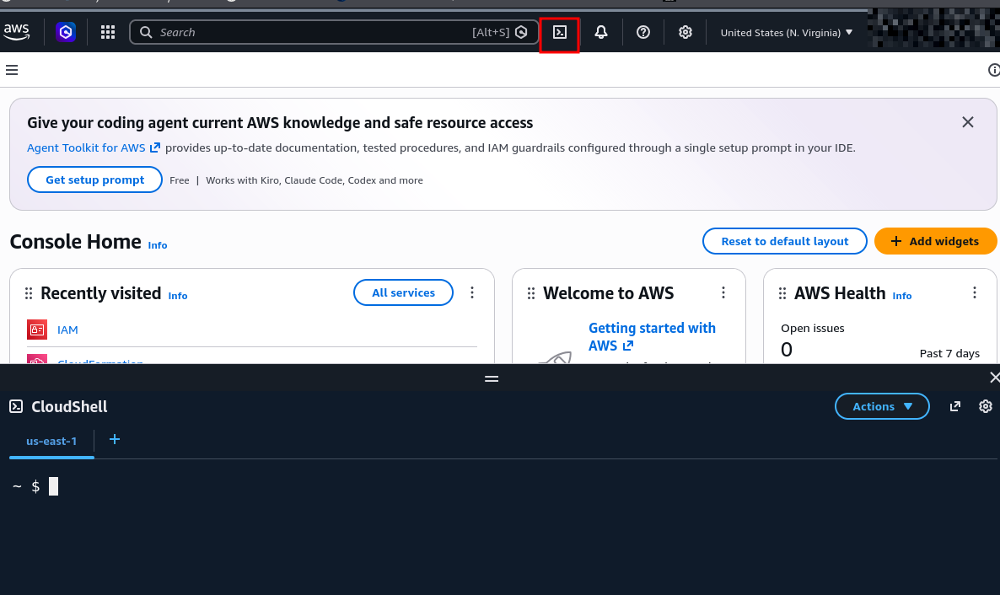

# Challenge Lab Name: `Discover AWS Organization ID via S3 Bucket`
<details open>
<summary><b>Scenario & Overview</b></summary>

> **Platform:** <a href="https://cybr.com" target="_blank" title="Open Cybr Labs Platform"></a> &nbsp;
>
>In this scenario, we're conducting a basic penetration test for a client who has provided IAM User credentials via an access key. This simulates stolen long-term credentials, a common source of AWS breaches. After completing basic enumeration from prior labs in [this course](https://cybr.com/courses/introduction-to-aws-enumeration/), you successfully discovered an IAM Role that appears to have access to an Amazon S3 bucket, but the S3 bucket seems is in a different AWS account. You already figured out which AWS account it belongs to from the prior lab, but now you want to know the AWS Organization ID.

</details>

# CURRENTLY A WORK IN PROGRESS (FIXING TECHNICAL ERRORS IN LAB)
## Detailed Methodology

<details open>
<summary><b>Initial Offensive Infrastructure Setup</b></summary>

In this lab I was given AWS credentials and found that there was a policy attached allowing the IAM user to view an S3 bucket. In this case, I chose to show how any AWS account can view the Organization ID from an S3 bucket by creating my own infrastructure. 

In order to enumerate an Organization ID using an S3 Bucket, you will need an AWS account, and then will need to create an IAM user and a IAM role with a trust policy that allows the IAM user to assume it (`sts:AssumeRole`). Another step is attaching a policy to the IAM role that will permit querying any owned or public S3 bucket.  

This lab provides the necessary infrastructure needed to complete the challenge, but if you want to create your own infrastructure, below is how I did it. 

> [!NOTE]  
> My AWS Account ID but you should see 12 random digits for your own AWS account ID.

Login in to your AWS account as the root user and click on the CloudShell terminal icon.

<div align="center">
  
  <p><em>Viewing the AWS Management Console and CloudShell terminal.</em></p>
</div>

#### IAM User Creation & Policy Attachment (Inline)
Start by creating an IAM user:
```bash
~ $ aws iam create-user --user-name s3user
{
    "User": {
        "Path": "/",
        "UserName": "s3user",
        "UserId": "AIDAT5ADERD2QSBUNGENV",
        "Arn": "arn:aws:iam::XXXXXXXXXXXX:user/s3user",
        "CreateDate": "2026-10-08T20:48:39+00:00"
    }
}
```
- Copy the ARN of the IAM user created, in my case it's `arn:aws:iam::XXXXXXXXXXXX:user/s3user`

Once you have the IAM user's ARN, edit this policy to use the ARN just copied. Copy and paste this into a JSON file, which mine will be labeled `s3user-policy.json`.
```json
{
    "Version": "2012-10-17",
    "Statement": {
        "Effect": "Allow",
        "Action": "sts:AssumeRole",
        "Resource": "arn:aws:iam::XXXXXXXXXXXX:user/s3user"
    }
}
```
- This policy will be attached to the IAM user to allow it to assume a role. 

Next, upload the JSON policy document to the **CloudShell** environment by clicking **Actions > Upload File**. You will get a successful upload message once it has completed downloading. 

When that is done, attach the policy to the IAM user using the **CloudShell** terminal. This policy will be attached as an inline policy (`https://docs.aws.amazon.com/IAM/latest/UserGuide/access_policies_managed-vs-inline.html`) :
```bash
aws iam put-user-policy --user-name s3user --policy-name MyInlinePolicy --policy-document file://s3user-policy.json
```
- There will be no output from this command

You can verify that the policy is attached to the IAM user by running:
```bash
~ $ aws iam list-user-policies --user-name s3user
{
    "PolicyNames": [
        "MyInlinePolicy"
    ]
}
```

Before moving onto the next step, make sure to create an access key for the IAM user running the command below. Make sure to copy this somewhere safe because it will be used later. 
```bash
~ $ aws iam create-access-key --user-name s3user
{
    "AccessKey": {
        "UserName": "s3user",
        "AccessKeyId": "[REDACTED ACCESS KEY]",
        "Status": "Active",
        "SecretAccessKey": "[REDACTED SECRET KEY]",
        "CreateDate": "2026-10-09T04:39:07+00:00"
    }
}
```
#### IAM Role Creation & Policy Attachment (Permission)
Once done with the IAM user and the inline policy attached to it, a IAM role needs to be created for the IAM user to assume.
- The role permissions need to allow S3 enumeration.

Before starting, make sure to copy and paste the trust policy below as a JSON file, which in my case will be labeleld as `trust-policy.json`. Make sure to insert the IAM user's ARN before saving the file as well.
```json
{
    "Version": "2012-10-17",
    "Statement": [
        {
            "Effect": "Allow",
            "Principal": {
                "AWS": "arn:aws:iam::XXXXXXXXXXXX:user/s3user"
            },
            "Action": "sts:AssumeRole"
        }
    ]
}
```

After saving the file, upload it to the **CloudShell** environment by again clicking **Actions > Upload File**. 

Now that the trust policy for the IAM role is uploaded, the IAM role `hacker` can be created with the trust policy by running:
```bash
~ $ aws iam create-role --role-name hacker --assume-role-policy-document file://trust-policy.json
{
    "Role": {
        "Path": "/",
        "RoleName": "hacker",
        "RoleId": "AROAT5ADERD254EGAWTPD",
        "Arn": "arn:aws:iam::XXXXXXXXXXXX:role/hacker",
        "CreateDate": "2026-10-09T04:03:46+00:00",
        "AssumeRolePolicyDocument": {
            "Version": "2012-10-17",
            "Statement": [
                {
                    "Effect": "Allow",
                    "Principal": {
                        "AWS": "arn:aws:iam::XXXXXXXXXXXX:user/s3user"
                    },
                    "Action": "sts:AssumeRole"
                }
            ]
        }
    }
}
```
- The IAM role ARN will be needed when running the `conditional-love.py` tool later

Once the command displays an output, the role policy to allow S3 enumeration for the IAM role can be uploaded to the **CloudShell** environment. 

Copy and paste the policy below as a JSON file, which in my case will be labeleld as `role-policy.json`. Like before, upload the JSON file to by clicking **Actions > Upload File**. You should get a successful upload message once it has completed downloading. 
```json
{
  "Version": "2012-10-17",
  "Statement": [
    {
      "Sid": "AllBucketsGetObject",
      "Effect": "Allow",
      "Action": "s3:GetObject",
      "Resource": "arn:aws:s3:::*/*"
    },
    {
      "Sid": "AllBucketsList",
      "Effect": "Allow",
      "Action": "s3:ListBucket",
      "Resource": "arn:aws:s3:::*"
    }
  ]
}
```

With the IAM role and trust policy attached to it are created, the managed policy for S3 enumeration can be attached to the role running: 
```bash
aws iam put-role-policy --role-name hacker --policy-name S3EnumPolicy --policy-document file://role-policy.json
```
- There will be no output for this command

To check that the policy is attached to the IAM role, run:
```bash
~ $ aws iam list-role-policies --role-name hacker
{
    "PolicyNames": [
        "S3EnumPolicy"
    ]
}
```

#### Configure AWS Profile 
Before getting started with the account ID enumeration, an AWS profile needs to be configured with the IAM user access key and secret key created earlier. This step should be done on your terminal instead of CloudShell.
```bash
└─$ aws configure --profile s3user

Tip: You can deliver temporary credentials to the AWS CLI using your AWS Console session by running the command 'aws login'.

AWS Access Key ID [None]: [REDACTED ACCESS KEY]
AWS Secret Access Key [None]: [REDACTED SECRET KEY]
Default region name [None]: us-east-1
Default output format [None]: json
```

</details>


<details open>
<summary><b>Enumerating for AWS Organization ID</b></summary>

In the lab I enumerated the policies of the IAM user I was given, which let me see a policy attached that allowed the user to view an S3 bucket that wasn't known before. In this case, I am going to say that the scenario is different and that I actually found this S3 bucket name viewing the source code of a website or from a GitHub repository. The S3 bucket that was found was `img.cybrlabs.io`. 


#### Tool Installation & Running the Script

To get started on finding the Organization ID related to this S3 bucket, I needed to install the `conditional-love` tool from GitHub which can be found [here](https://github.com/plerionhq/conditional-love/).

Below are the commands I used to install the tool on my local machine. 

```bash
git clone https://github.com/plerionhq/conditional-love.git
cd conditional-love
python3 -m venv .venv
source .venv/bin/activate
pip install -r requirements.txt
chmod +x ./conditional-love.py
```

Next it was time to run the command that would find the AWS Organization ID based on the S3 bucket found earlier. 

```bash
└─$ ./conditional-love.py --role arn:aws:iam::XXXXXXXXXXXX:role/hacker --target s3://img.cybrlabs.io --action=s3:HeadObject --condition=aws:ResourceOrgID --alphabet="0123456789abcdefghijklmnopqrstuvwxyz-" --profile org
Starting to be wrong. Please be patient...
=> o
=> o-
=> o-8
=> o-8q
=> o-8qt
=> o-XXXX
=> o-XXXXX
=> o-XXXXXX
=> o-XXXXXXX
=> o-XXXXXXXX
=> o-XXXXXXXXX
=> o-XXXXXXXXXX
```

The flags needed for this command are:

- `--role` which is the role ARN copied earlier and that the IAM user assumes. 
- `--target` which is the S3 bucket, `img.cybrlabs.io`.
- `--action` which is `s3:HeadObject`. 
- `--condition` which is `aws:ResourceOrgID`

A flag that is optional when running this tool, but is also helpful is:
- `--alphabet` since Organization IDs can contain any of these characters: `0123456789abcdefghijklmnopqrstuvwxyz-`


Multiple attempts are made with different policies using different characters, until it finds the right combination for the `aws:resourceOrgID`. 

</details>


<details open>
<summary><b>Impact & Post-Exploitation Potential</b></summary>

The Organization ID itself is not sensitive information, but it does provide attackers with knowledge about the AWS infrastructure that is attached to the S3 bucket. I think that this YouTube [video](https://youtu.be/jq8SAF6ibSc?si=bsH32SwVPtvu3B7w&t=1023) was really helpful in understanding more about AWS Organizations and how accounts are managed within if you want to learn more. 

</details>


